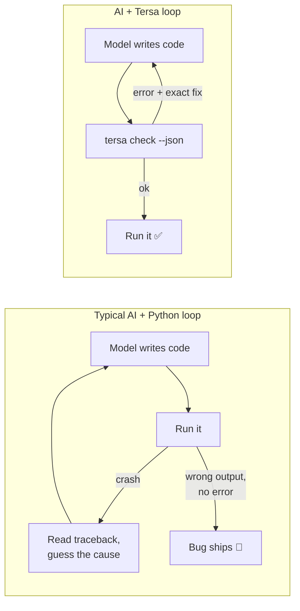
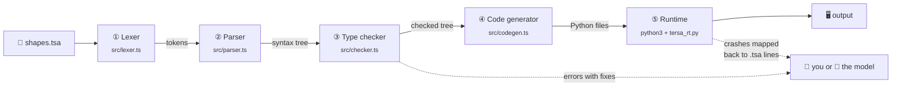
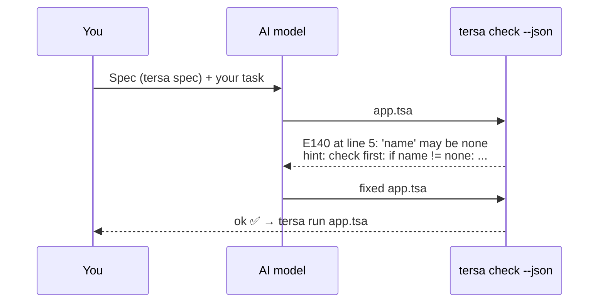

<div align="center">

# Tersa

**A compact, type-safe programming language built for code written by AI.**

Looks like Python · checked like Rust · runs on Python 3.10+

[](CHANGELOG.md)
[](LICENSE)
[](test)
[](https://nodejs.org)
[](https://python.org)

[**Quick start**](#-quick-start) · [**Language tour**](#-language-tour) · [**How it works**](#%EF%B8%8F-how-it-works-the-whole-process) · [**Bug gallery**](#-bug-gallery) · [**Benchmarks**](#-benchmarks) · [**Spec**](docs/SPEC.md)

</div>

```python
type Shape = Circle(r: float) | Rect(w: float, h: float)

fn area(s: Shape) -> float:
    match s:
        Circle(r): pi * r * r
        Rect(w, h): w * h

shapes = [Circle(1.0), Rect(2.0, 3.0)]
print("total area: {shapes.map(area).sum():.2f}")
```

```console
$ tersa run shapes.tsa
total area: 9.14
```

<table>
<tr>
<td align="center" width="33%"><h3>6–58% fewer tokens</h3>than Python, TypeScript, Go and Java for the same programs</td>
<td align="center" width="33%"><h3>13 / 13 AI bugs caught</h3>before running, vs 6 / 13 for Python + mypy</td>
<td align="center" width="33%"><h3>~2,100-token spec</h3>the whole language fits in one prompt</td>
</tr>
</table>

> [!TIP]
> Every section below that starts with ▶ is collapsible. Click it to expand.

---

## 📑 Contents

| | Section | What you'll learn |
|---|---|---|
| 1 | [Why Tersa exists](#-why-tersa-exists) | The two costs of AI-written code, and how a language can cut them |
| 2 | [Quick start](#-quick-start) | Install and run your first program in under a minute |
| 3 | [Language tour](#-language-tour) | Every feature, one concept at a time |
| 4 | [How it works: the whole process](#%EF%B8%8F-how-it-works-the-whole-process) | One program followed through all five compiler stages, with real output |
| 5 | [Bug gallery](#-bug-gallery) | Real mistakes, what Python does with them, what Tersa says |
| 6 | [Benchmarks](#-benchmarks) | Token counts and bug-catching, with a way to reproduce them |
| 7 | [Using Tersa with an AI model](#-using-tersa-with-an-ai-model) | The write → check → fix loop |
| 8 | [Design decisions](#-design-decisions) | Why each rule exists |
| 9 | [Project structure](#-project-structure) | Where everything lives in this repo |
| 10 | [Roadmap](#%EF%B8%8F-roadmap) | What's done and what's next |

---

## 💡 Why Tersa exists

LLMs write a lot of code now. Two things make that code expensive:

1. **Tokens.** Every program is generated, read back, and edited token by token. Verbose languages cost more on every turn.
2. **Bugs.** Each crash or wrong answer costs another round trip, and the worst bugs don't crash at all: they quietly print the wrong result.

Python is the language models know best, but it lets whole classes of mistakes through until the code runs (or never reports them at all). Java and Go catch more mistakes but cost 50% more tokens. Tersa keeps Python's shape and adds a strict compiler whose error messages are written for a model to read and fix in one step.



---

## 🚀 Quick start

> [!NOTE]
> You need **Node.js 18+** (runs the compiler) and **Python 3.10+** (runs your programs).

**1. Install** (straight from this repo)

```bash
npm install -g github:TahaSaiyed08/tersa
```

**2. Write** `hello.tsa`

```python
name = "world"
print("Hello, {name}!")
```

**3. Run**

```console
$ tersa run hello.tsa
Hello, world!
```

<details>
<summary><b>▶ All commands</b></summary>

<br>

| Command | What it does |
|---|---|
| `tersa run app.tsa [args]` | Type-check, compile to Python, and run |
| `tersa check app.tsa` | Type-check only, with readable errors |
| `tersa check app.tsa --json` | Type-check, with machine-readable errors for tools and AI agents |
| `tersa test app.tsa` | Run the file's `test` blocks |
| `tersa build app.tsa -o out` | Write plain Python files (run them with `python out/app.py`) |
| `tersa spec` | Print the compact language spec to paste into a prompt |
| `tersa version` | Print the version |

Set `TERSA_PYTHON` to choose a specific Python interpreter.

</details>

<details>
<summary><b>▶ Install from source instead</b></summary>

<br>

```bash
git clone https://github.com/TahaSaiyed08/tersa.git
cd tersa
npm install          # also builds the compiler
npm test             # 106 tests
node dist/cli.js run examples/hello.tsa
```

</details>

---

## 🧭 Language tour

Each block below is a complete program you can save as a `.tsa` file and run.

<details open>
<summary><b>▶ 1. Variables: immutable unless you say <code>var</code></b></summary>

<br>

```python
x = 5               # immutable
var count = 0       # mutable
count += 1
price: float = 2    # optional type annotation (stores 2.0)
a, b = (1, "one")   # unpacking
print(x, count, price, a, b)
```

Think of `var` like writing in pencil instead of pen: you only get an eraser when you ask for one. The compiler rejects any change to something you didn't mark `var`, including `push` on a list or setting a field.

</details>

<details>
<summary><b>▶ 2. Functions: the last line is the answer</b></summary>

<br>

```python
fn add(a: int, b: int) -> int:
    a + b                                   # no 'return' needed

fn square(x: float) = x * x                 # one-liner; return type inferred

fn greet(name: str, loud: bool = false):
    print(if loud: name.upper() else: name)

fn biggest[T: ord](xs: [T]) -> T = xs.max()  # generic

greet("ada", loud=true)
print(add(2, 3), square(1.5), biggest(["b", "c", "a"]))
print([1, 2, 3].map(x => x * 10))           # lambdas: x => ...
print(3.add(4))                             # any function can be called like a method
```

Parameters always need types; everything else is inferred. Recursive functions declare their return type.

</details>

<details>
<summary><b>▶ 3. Records and choice types</b></summary>

<br>

```python
type Point(x: float, y: float = 0.0)            # a record (immutable)
type Account(owner: str, var balance: int = 0)  # 'var' field can change

type Shape = Circle(r: float) | Rect(w: float, h: float) | Empty   # a choice type

fn Point.norm() = sqrt(self.x ** 2 + self.y ** 2)                  # a method

p = Point(3.0, 4.0)
moved = p.with(x=6.0)          # copy with one field changed
acct = Account("ada")
acct.balance += 50
print(p.norm(), moved, acct, Empty)
```

A choice type is like a menu: a `Shape` is exactly one of the listed options, and each option carries its own data.

</details>

<details>
<summary><b>▶ 4. <code>match</code>: handle every case or it won't compile</b></summary>

<br>

```python
type Payment = Card(last4: str) | Cash | Voucher(code: str)

fn fee(p: Payment) -> float:
    match p:
        Card(_): 0.30
        Cash: 0.0
        Voucher(code) if code.starts_with("FREE"): 0.0
        Voucher(_): 0.10

fn size(n: int) -> str:
    match n:
        0: "zero"
        1 | 2 | 3: "small"
        _: "large"

print(fee(Card("4242")), fee(Voucher("FREE1")), size(2))
```

Delete any arm and the compiler names the exact case you forgot: `missing Voucher(_)`.

</details>

<details>
<summary><b>▶ 5. Optionals: <code>none</code> instead of null, and you must check it</b></summary>

<br>

```python
fn find(id: int) -> str?:          # str? means "a str, or none"
    if id == 1: return "alice"
    none

name = find(2)
if name != none:
    print(name.upper())            # inside this block, name is a plain str

print(find(2) ?? "anonymous")      # ?? gives a default
print(find(1)!)                    # ! means "I'm sure", and stops the program if it's none
```

`str?` is like a gift box that might be empty. You can't use what's inside until you've looked in the box. Calling `name.upper()` without checking is a compile error, not a crash at 2 a.m.

</details>

<details>
<summary><b>▶ 6. Results: errors are values, not exceptions</b></summary>

<br>

```python
fn parse_age(s: str) -> int!str:          # int!str: an int, or an error message
    n = s.parse_int()
    if n == none: return err("not a number: {s}")
    ok(n)

fn total(xs: [str]) -> int!str:
    var sum = 0
    for x in xs:
        sum += parse_age(x)?               # ? passes the error up early
    ok(sum)

fn save(path: str, text: str) -> !str:     # !str: succeeds with nothing, or fails
    write_file(path, text)?

match total(["30", "x"]):
    ok(v): print("total", v)
    err(e): print("failed:", e)
```

There is no `try`/`except`. A function that can fail says so in its type, and the compiler makes the caller deal with it. Ignoring a result is an error.

</details>

<details>
<summary><b>▶ 7. Collections</b></summary>

<br>

```python
nums = [5, 3, 8, 1]
print(nums.sort(), nums.filter(n => n > 2).sum(), nums.first() ?? 0)

var ages = {"ada": 36, "alan": 41}
ages["grace"] = 85
for name, age in ages.items():
    print("{name:<6} {age:>3}")

squares = [x * x for x in 1..=5 if x % 2 == 1]
lengths = {w: len(w) for w in ["hi", "hello"]}
unique = set([1, 2, 2, 3])
print(squares, lengths, unique, 3 in unique)
```

`sort`, `map`, `filter` and friends return new lists. 128 built-in functions are listed in [docs/STDLIB.md](docs/STDLIB.md).

</details>

<details>
<summary><b>▶ 8. Modules and Python libraries</b></summary>

<br>

```python
extern "statistics":                 # call any Python module, with declared types
    fn median(xs: [float]) -> float
extern "math":
    fn gcd(a: int, b: int) -> int

data = parse_json(r"""{"name": "Ada", "langs": ["py", "ts"]}""")!
print(median([3.0, 1.0, 2.0]), gcd(12, 18), data["name"] as str)
```

Split code across files with `use`:

```text
use geometry                 # everything public from geometry.tsa
use geometry: area, Shape    # just these
use lib.geometry as g        # g.area(...), from lib/geometry.tsa
```

</details>

<details>
<summary><b>▶ 9. Tests</b></summary>

<br>

```python
fn add(a: int, b: int) -> int = a + b

test "adds numbers":
    assert add(2, 3) == 5
    assert add(-1, 1) == 0, "negatives"
```

```console
$ tersa test math.tsa
  ✓ adds numbers
1 passed, 0 failed
```

</details>

---

## ⚙️ How it works: the whole process

Tersa is a **compiler**: it translates Tersa into Python, then hands that Python to `python3`. Think of it as a strict editor checking your manuscript before it goes to the printer. Nothing reaches the printer (Python) until the editor (the type checker) is satisfied.



We'll follow the `shapes.tsa` program from the top of this page through each stage. Everything shown below is real output from the compiler.

<details>
<summary><b>▶ ① Lexer: text → tokens</b></summary>

<br>

The lexer reads characters and groups them into **tokens**, the "words" of the language. Because Tersa uses indentation for blocks (like Python), the lexer also produces `INDENT` and `DEDENT` tokens when the indentation changes.

Input (lines 3–5 of `shapes.tsa`):

```python
fn area(s: Shape) -> float:
    match s:
        Circle(r): pi * r * r
```

Tokens produced:

```text
kw(fn) name(area) op(() name(s) op(:) name(Shape) op()) op(->) name(float) op(:) NEWLINE
INDENT kw(match) name(s) op(:) NEWLINE
INDENT name(Circle) op(() name(r) op()) op(:) name(pi) op(*) name(r) op(*) name(r) NEWLINE
```

It also splits string interpolation (`"{x:.2f}"`) into text and expression parts, and catches typing slips early, with a hint (`'single quotes'` → use double quotes, `&&` → use `and`, tabs → use spaces).

</details>

<details>
<summary><b>▶ ② Parser: tokens → syntax tree</b></summary>

<br>

The parser arranges the tokens into a tree that shows how the program is structured: which expression belongs to which function, what's inside each `match` arm, which operator applies first.

The tree for `fn area`, drawn from the parser's real output:

```text
fn area
├── param  s : Shape
├── returns  float
└── body
    └── match s
        ├── arm  Circle(r)
        │   └── (pi * r) * r
        └── arm  Rect(w, h)
            └── w * h
```

<details>
<summary>See the raw tree (JSON, trimmed)</summary>

```json
{
  "k": "fn", "name": "area",
  "params": [{ "name": "s", "type": { "k": "tname", "name": "Shape" } }],
  "ret": { "k": "tname", "name": "float" },
  "body": { "stmts": [{ "k": "expr", "expr": {
    "k": "match", "subject": { "k": "name", "name": "s" },
    "arms": [
      { "pattern": { "k": "pctor", "name": "Circle", "args": [{ "k": "pbind", "name": "r" }] },
        "body": { "k": "binary", "op": "*",
                  "left": { "k": "binary", "op": "*", "left": { "k": "name", "name": "pi" }, "right": { "k": "name", "name": "r" } },
                  "right": { "k": "name", "name": "r" } } },
      { "pattern": { "k": "pctor", "name": "Rect", "args": [{ "k": "pbind", "name": "w" }, { "k": "pbind", "name": "h" }] },
        "body": { "k": "binary", "op": "*", "left": { "k": "name", "name": "w" }, "right": { "k": "name", "name": "h" } } }
    ] } }] }
}
```

</details>

The parser uses **recursive descent**: one function per grammar rule (`ifExpr`, `matchExpr`, `postfix`, …), with operator precedence handled by a chain of functions from loosest (`or`) to tightest (`**`).

</details>

<details>
<summary><b>▶ ③ Type checker: the stage that catches the bugs</b></summary>

<br>

This is the heart of Tersa. It walks the tree and works out the type of every expression, then checks that everything fits. For `shapes.tsa` it works out, for example:

| Expression | Type it infers |
|---|---|
| `Circle(1.0)` | `Shape` |
| `shapes` | `[Shape]` (a list of shapes) |
| `shapes.map(area)` | `[float]` |
| `shapes.map(area).sum()` | `float` |
| `"{...:.2f}"` | `str`, and `:.2f` is allowed because the value is a number |

What it checks:

| Check | Example it rejects |
|---|---|
| Types match | `"age " + 30` |
| `none` is handled | `find(id).upper()` when `find` returns `str?` |
| Errors are handled | ignoring a `write_file(...)` result |
| `match` covers every case | forgetting the `Rect` arm |
| Only `var` things change | `xs.push(1)` when `xs` isn't `var` |
| Conditions are real booleans | `if items:` (write `if len(items) > 0:`) |
| Results aren't thrown away | `name.trim()` on a line by itself |
| Functions always return | an `if` with no `else` path in a function returning `int` |

It also **narrows** types as it reads: after `if x == none: return`, it knows `x` can't be `none` for the rest of the block.

Here's what happens if we delete the `Rect` arm from `area`:

```console
$ tersa check shapes.tsa
error[E130] shapes.tsa:4:5: match is not exhaustive: missing Rect(_, _)
  |
4 |     match s:
  |     ^^^^^
  help: add arm for Rect(_, _) (or a catch-all '_: ...')

1 error found
```

And the same error for a tool or AI agent:

```console
$ tersa check shapes.tsa --json
```

```json
{
  "ok": false,
  "diagnostics": [
    {
      "severity": "error",
      "code": "E130",
      "message": "match is not exhaustive: missing Rect(_, _)",
      "file": "shapes.tsa",
      "line": 4,
      "col": 5,
      "endCol": 10,
      "hint": "add arm for Rect(_, _) (or a catch-all '_: ...')"
    }
  ]
}
```

Every error has a stable code (listed in [docs/SPEC.md](docs/SPEC.md#15-diagnostics)), an exact position, and, for common mistakes, a `hint` with the fix.

</details>

<details>
<summary><b>▶ ④ Code generator: checked tree → Python</b></summary>

<br>

Once the program passes the checker, the code generator writes ordinary Python. `tersa build shapes.tsa -o out` produces exactly this:

```py
# Generated by Tersa 0.1.0 from shapes.tsa. Do not edit.
_TS_SRC = "shapes.tsa"; _TS_LINES = [0,0,0,0,1,1,1,1,1,1,1,1,1,1,1,1,3,3,4,5,5,6,6,8,8,9,0]
import tersa_rt as _rt

class Shape:
    pass
@_rt.dataclass(frozen=True)
class Circle(Shape):
    _tsa_variant = True
    r: object
@_rt.dataclass(frozen=True)
class Rect(Shape):
    _tsa_variant = True
    w: object
    h: object

def area(s):
    match s:
        case Circle(r):
            return ((_rt.math.pi * r) * r)
        case Rect(w, h):
            return (w * h)

shapes = [Circle(1.0), Rect(2.0, 3.0)]
_rt.tsa_print(("total area: " + format(sum(list(map(area, shapes))), ".2f")))
```

How each piece translates:

| Tersa | Python |
|---|---|
| `type Shape = Circle(...) \| Rect(...)` | a base class plus one frozen dataclass per option |
| `match` | Python 3.10 `match` / `case` |
| last expression of a function | `return ...` |
| `ok(v)` / `err(e)` | `_rt.Ok(v)` / `_rt.Err(e)` from the runtime |
| `x?` | a helper that returns early on `none` or an error |
| `none` | `None` |

`_TS_LINES` is a **line map**: entry *n* is the `.tsa` line that produced Python line *n*. The next stage uses it.

</details>

<details>
<summary><b>▶ ⑤ Runtime: running the Python, reporting errors in Tersa terms</b></summary>

<br>

`tersa run` writes the generated files plus a small runtime (`tersa_rt.py`) to a temporary folder and starts Python through a bootstrap script. If the program crashes, the bootstrap uses the line map to report the **Tersa** line, not the Python one:

```python
type Order(id: int, qty: int)
fn unit_price(o: Order) = 100.0 / o.qty
fn total(orders: [Order]) = orders.map(unit_price).sum()
print(total([Order(1, 2), Order(2, 0)]))
```

```console
$ tersa run orders.tsa
panic: division by zero
  at orders.tsa:2 in unit_price
  at orders.tsa:3 in total
  at orders.tsa:4
```

No Python traceback, no generated file names: just where the problem is in the code you (or the model) actually wrote.

</details>

---

## 🐛 Bug gallery

Real mistakes that LLMs commonly make. The Python column is what actually happens when you run it; the Tersa column is the real compiler output.

<details open>
<summary><b>▶ Using a value that might be missing</b></summary>

<table>
<tr><th>Python</th><th>Tersa</th></tr>
<tr>
<td>

```py
users = {1: "alice"}

def shout(uid):
    name = users.get(uid)
    return name.upper()

print(shout(2))
```

💥 `AttributeError: 'NoneType' object has no attribute 'upper'`, at runtime

</td>
<td>

```python
users = {1: "alice"}

fn shout(uid: int) -> str:
    name = users.get(uid)
    name.upper()

print(shout(2))
```

```text
error[E140] 'name' may be none, so calling
.upper() isn't safe
  help: check first: if name != none: ...,
  or use name!.upper(...)
```

</td>
</tr>
</table>

</details>

<details>
<summary><b>▶ "Truthiness" hides a real zero</b></summary>

<table>
<tr><th>Python</th><th>Tersa</th></tr>
<tr>
<td>

```py
def describe(discount):
    if discount:
        return f"discount {discount}"
    return "no discount"

print(describe(0.0))
```

😶 prints `no discount` for a real 0% discount. No error, wrong answer.

</td>
<td>

```python
fn describe(discount: float?) -> str:
    if discount: return "discount {discount}"
    "no discount"

print(describe(0.0))
```

```text
error[E170] if condition needs a bool,
but this is float?
  help: compare explicitly: discount != none
```

</td>
</tr>
</table>

</details>

<details>
<summary><b>▶ Forgetting a new case</b></summary>

<table>
<tr><th>Python</th><th>Tersa</th></tr>
<tr>
<td>

```py
def fee(p):
    match p:
        case Card():
            return 0.3
        case Cash():
            return 0.0
    return 0.0

print(fee(Voucher("X1")))
```

😶 prints `0.0`: the new `Voucher` type is silently free.

</td>
<td>

```python
type Payment = Card(last4: str) | Cash | Voucher(code: str)
fn fee(p: Payment) -> float:
    match p:
        Card(_): 0.3
        Cash: 0.0
```

```text
error[E130] match is not exhaustive:
missing Voucher(_)
  help: add arm for Voucher(_)
```

</td>
</tr>
</table>

</details>

<details>
<summary><b>▶ Calling a method and throwing away the answer</b></summary>

<table>
<tr><th>Python</th><th>Tersa</th></tr>
<tr>
<td>

```py
def clean(name):
    name.strip()
    return name

print(repr(clean("  bob  ")))
```

😶 prints `'  bob  '`: `strip()` returned a new string that nobody used.

</td>
<td>

```python
fn clean(name: str) -> str:
    name.trim()
    name
```

```text
error[E141] the result of 'trim' is discarded;
trim() returns a new value and doesn't
change anything
  help: store it in a new variable:
  new_name = name.trim()
```

</td>
</tr>
</table>

</details>

<details>
<summary><b>▶ Changing a shared object by accident</b></summary>

<table>
<tr><th>Python</th><th>Tersa</th></tr>
<tr>
<td>

```py
DEFAULT_LIMITS = {"cpu": 2, "ram": 4}

def for_premium():
    limits = DEFAULT_LIMITS
    limits["cpu"] = 8
    return limits

for_premium()
print(DEFAULT_LIMITS)
```

😶 prints `{'cpu': 8, 'ram': 4}`: the shared default was changed for everyone.

</td>
<td>

```python
DEFAULT_LIMITS = {"cpu": 2, "ram": 4}
fn for_premium() -> {str: int}:
    limits = DEFAULT_LIMITS
    limits["cpu"] = 8
    limits
```

```text
error[E121] can't assign to 'limits': it is
immutable, and it is the same object as
'DEFAULT_LIMITS'
  help: to change a separate copy:
  var limits = DEFAULT_LIMITS.copy()
```

</td>
</tr>
</table>

</details>

<details>
<summary><b>▶ Bugs Tersa removes by design</b></summary>

<br>

Some Python traps can't happen in Tersa at all, because the language works differently:

| Trap | Python | Tersa |
|---|---|---|
| Loop closures | `[lambda: i for i in range(3)]` all return `2` | each closure keeps its own `i`: `[0, 1, 2]` |
| Mutable default arguments | `def f(x, acc=[])` shares one list across calls | defaults are created fresh on every call |
| `None` vs missing key vs `0` | all "falsy", easy to mix up | no truthiness; `none` only where the type says `T?` |
| Exceptions you forgot to catch | any call might raise | failures are in the return type (`T!E`) |

</details>

The full set of 13 cases, with Python, mypy, and Tersa results side by side, is in [benchmarks/BUGS.md](benchmarks/BUGS.md).

---

## 📊 Benchmarks

### Tokens

Eight programs (fizzbuzz, word frequency, shapes, bank transfers, CSV report, inventory, binary tree, todo list), each written idiomatically in every language. A script checks that **all 48 versions print byte-identical output**, so the comparison is like for like.

| Language | Tokens | | vs Tersa |
|---|---:|---|---:|
| **Tersa** *(fully typed)* | **1,976** | `███████████████████` | |
| Python *(no types)* | 2,100 | `████████████████████` | +6% |
| Python *(type hints)* | 2,384 | `███████████████████████` | +21% |
| TypeScript | 2,472 | `████████████████████████` | +25% |
| Go | 2,895 | `████████████████████████████` | +47% |
| Java | 3,127 | `██████████████████████████████` | +58% |

The headline: **Tersa is fully type-checked yet shorter than untyped Python.** Type-hinted Python, the fair comparison for safety, uses 21% more tokens.

<details>
<summary><b>▶ Per-program numbers and method</b></summary>

<br>

| Program | Tersa | Python | Python (typed) | TypeScript | Go | Java |
|---|---:|---:|---:|---:|---:|---:|
| bank | 226 | 234 | 257 | 288 | 307 | 365 |
| csv_report | 351 | 383 | 412 | 467 | 541 | 540 |
| fizzbuzz | 69 | 76 | 81 | 86 | 102 | 109 |
| inventory | 288 | 307 | 327 | 393 | 462 | 476 |
| shapes | 286 | 336 | 373 | 377 | 424 | 418 |
| todo | 290 | 319 | 345 | 326 | 387 | 437 |
| tree | 366 | 343 | 471 | 389 | 458 | 592 |
| word_freq | 100 | 102 | 118 | 146 | 214 | 190 |

- Tokens are counted with OpenAI's public `o200k_base` tokenizer (the `cl100k_base` numbers are within 1%). Not every model's tokenizer is public, so treat these as a proxy: the relative differences are what matter.
- Where Tersa wins most: choice types and `match` (shapes, tree vs Java), format specs, implicit returns, inferred return types.
- Where it doesn't: the binary tree is slightly longer than untyped Python (which skips all the type declarations), and the tiny word-count script is a tie.
- Sources: [benchmarks/tasks](benchmarks/tasks). Full report: [benchmarks/RESULTS.md](benchmarks/RESULTS.md).

</details>

### Bugs caught before running

| | Caught or prevented | Silently wrong at runtime |
|---|---:|---:|
| Plain Python | 0 / 13 | 6 / 13 |
| Python + `mypy --strict` | 6 / 13 | — |
| **Tersa** | **13 / 13** | **0 / 13** |

> [!IMPORTANT]
> These 13 cases are a curated set of common mistake patterns. They show *which kinds* of bugs Tersa stops, not a measured bug rate across all AI-written code.

### Reproduce

```bash
npm run bench                 # token counts  → benchmarks/RESULTS.md
npm run bench:bugs            # bug benchmark → benchmarks/BUGS.md (mypy optional)
bash benchmarks/verify.sh     # checks every version prints identical output
```

---

## 🤖 Using Tersa with an AI model



**Step 1.** Put the spec in the system prompt or project instructions:

```bash
tersa spec > TERSA_SPEC.txt     # ~2,100 tokens: the whole language
```

**Step 2.** Ask for code, using a prompt like this:

```text
You write programs in Tersa. The full language spec is below.
Reply with one complete .tsa file and nothing else.

<spec>
...paste TERSA_SPEC.txt here...
</spec>

Task: read a CSV of sales from sales.csv and print revenue per region.
```

**Step 3.** Check the result and send back any diagnostics:

```bash
tersa check app.tsa --json
```

Each diagnostic includes the line, column, and a `hint` with the fix, so the model can usually correct the code in one step.

---

## 🧩 Design decisions

Every rule in Tersa exists to save tokens, prevent a bug, or both.

| Decision | Saves tokens | Prevents bugs | Why |
|---|:---:|:---:|---|
| Python-like syntax and indentation | ✅ | | Models already know it, and no braces or semicolons |
| Last expression is the return value | ✅ | | `a + b` instead of `return a + b` |
| Return types are inferred | ✅ | | still fully checked; only recursion needs one |
| `if` and `match` produce values | ✅ | ✅ | no half-assigned variables across branches |
| Choice types (`A \| B(x)`) | ✅ | ✅ | one line instead of a class hierarchy, and `match` must cover them all |
| `T?` instead of null | | ✅ | the most common crash in any language becomes a compile error |
| `T!E` results instead of exceptions | | ✅ | failure is part of the signature, so callers can't forget it |
| Immutable by default, `var` to change | | ✅ | stops accidental changes to shared lists and maps |
| No truthiness | | ✅ | `0`, `""`, `[]` and `none` can't be confused |
| Results can't be silently discarded | | ✅ | catches `name.trim()` and ignored errors |
| Errors carry a `hint` | | ✅ | models fix code faster with a concrete suggestion |
| Compiles to Python | | | instant access to every Python library through `extern` |

<details>
<summary><b>▶ What Tersa deliberately leaves out</b></summary>

<br>

- **Classes and inheritance**: records, choice types and methods cover the common cases with less code.
- **Exceptions**: replaced by results for expected failures; `panic` for real bugs.
- **Truthiness, `null`, implicit conversions**: each is a frequent source of silent bugs.
- **Several ways to do the same thing**: one way means more predictable code from a model.

</details>

---

## 📁 Project structure

```text
tersa/
├── src/
│   ├── lexer.ts         ① text → tokens (indentation, strings, interpolation)
│   ├── parser.ts        ② tokens → syntax tree
│   ├── checker.ts       ③ type checker and every diagnostic
│   ├── types.ts            type representation, unification, inference helpers
│   ├── codegen.ts       ④ syntax tree → Python
│   ├── runtime.ts       ⑤ the Python runtime + bootstrap shipped with programs
│   ├── builtins.ts         the 128-function standard library (signatures + Python)
│   ├── compile.ts          module loading and the full pipeline
│   └── cli.ts              the `tersa` command
├── llms.txt             the whole language in ~2,100 tokens, for prompts
├── docs/                SPEC.md (reference), STDLIB.md, PUBLISHING.md
├── examples/            10 runnable programs, each with its expected output
├── test/                106 compiler tests (node --test)
├── benchmarks/          token benchmark (6 languages) and AI-bug benchmark
└── editors/vscode/      syntax highlighting for .tsa files
```

The compiler is about 5,000 lines of TypeScript with **no runtime dependencies**.

---

## 🗺️ Roadmap

- [x] Language core: records, choice types, generics, optionals, results, `match`
- [x] Type checker with inference, narrowing, and fix hints
- [x] Compiler to Python with `.tsa` line mapping
- [x] Modules and typed Python interop
- [x] Test blocks, `--json` diagnostics, 128-function standard library
- [x] Token and AI-bug benchmarks
- [x] VS Code syntax highlighting
- [ ] Publish to npm
- [ ] Language server (autocomplete, errors as you type)
- [ ] Formatter (`tersa fmt`)
- [ ] Interfaces / traits
- [ ] `async` functions
- [ ] Browser playground
- [ ] LLM eval: how often models write compiling Tersa from the spec alone

---

## 🤝 Contributing

Issues and pull requests are welcome. Start with [CONTRIBUTING.md](CONTRIBUTING.md); it explains the layout and how to add a built-in or a new check.

```bash
npm install && npm test
```

## 📄 License

[MIT](LICENSE) © 2026 Taha Saiyed
